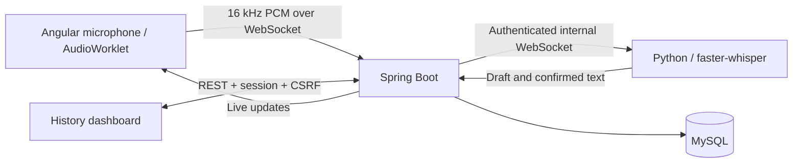

# Voiceline — real-time multilingual speech to text

An Angular / Spring Boot / MySQL application with a self-hosted Whisper speech service. Speak into your microphone, see draft text while speaking, and keep searchable, editable transcription history.

**Cloud deployment:** not published yet; hosting will be selected after the local build. The Docker configuration below runs the complete application, including MySQL. No paid speech API is needed.

## Features

- Angular 21 standalone application, responsive studio and dashboard, accessible dialogs.
- Microphone capture with AudioWorklet; stateful 16 kHz, mono, signed PCM conversion.
- Spring Boot 3.5 / Java 21 WebSocket relay and REST API.
- Self-hosted `faster-whisper`, multilingual model, transcription rather than translation.
- Replaceable draft text; confirmed text saved progressively on pauses and during long utterances.
- MySQL 8.4, Flyway migrations, Spring Data JPA, database-backed visitor sessions.
- Create / view / edit / delete transcripts; search, pagination, copy and TXT export.
- Original recognized text remains available after edits.
- Session ownership checks, CSRF protection, origin restrictions, bounded queues and recordings.
- Honest readiness and failure states; confirmed text survives interrupted connections.

## Quick start with Docker

Prerequisites: Docker Engine / Docker Desktop with Compose, internet access for the first model download, and a machine with enough RAM for Java, MySQL, and Whisper. Begin with roughly 4 CPU cores and 8 GB RAM; benchmark before selecting cloud hardware. This is a starting estimate, not a performance guarantee.

```sh
cp .env.example .env
# Replace all three password/token placeholders with distinct random values.
# Example secret generator: openssl rand -hex 32
docker compose up --build -d
docker compose logs -f speech
```

Open **http://localhost:4200**. The first launch downloads the configured model into a persistent volume. Recording becomes available when the service reports ready. `APP_ORIGIN` must exactly match the browser origin (scheme, hostname, and port).

```sh
docker compose ps
docker compose logs backend
docker compose down       # Retains database and model volumes
```

Do not use `docker compose down -v` unless you intend to erase saved data.

## How live transcription works



Whisper is a batch model wrapped in an incremental pipeline; this is near-real-time transcription, not token-by-token streaming from a native streaming model. Audio is decoded about every two seconds, or at a detected pause. Draft text is replaced, not appended, so revisions do not duplicate it. Confirmed text is committed on pauses. For long utterances, complete word timestamps allow trimming while retaining undecided audio at the end. Silence is screened with energy checks and the model's VAD.

The browser receives `ready`, `update`, `final`, and `error` events. Stop sends the remaining audio before finalization. Each finalized update is persisted before being forwarded. A disconnection marks the recording interrupted; text that was still a draft may be lost.

### Model and language choices

Default: multilingual `small`, CPU, int8. The internal service is isolated from the public network. `WHISPER_MODEL=medium` or `large-v3` can improve recognition but needs more compute. Rebuild/restart the service after configuration changes. The included image is CPU-only; GPU deployment requires a compatible CUDA runtime and container configuration.

Hindi–English code-switching is a target, not a guaranteed accuracy claim. Language detection can change script, transliterate words, or misrecognize short fragments. We do not post-process output to invent English spellings or translate Hindi. Use real code-switched recordings to evaluate a model before presenting accuracy claims.

## Repository

```text
frontend/          Angular studio, AudioWorklet, resampling tests, Nginx
backend/           Spring Boot API, WebSocket bridge, JPA, Flyway, tests
speech-service/    Whisper worker, bounded audio buffer, tests, smoke client
infra/             HTTPS gateway configuration
.github/workflows/ Build and test, including MySQL-backed migration test
```

## API

All paths are same-origin. Obtain a visitor session and token with `GET /api/session`. Send the returned token as `X-CSRF-Token` on mutations; keep the session cookie. Sessions last up to 30 days and are stored in MySQL so restarts do not lose access to history. This is browser-specific access, not a multi-device user account. Clearing cookies or session expiry loses access to the old visitor's history; records remain until explicitly deleted or an operator applies a retention policy.

| Method | Path | Purpose |
|---|---|---|
| GET | `/api/session` | Session cookie and CSRF token |
| GET | `/api/readiness` | Speech-model readiness |
| POST | `/api/transcriptions` | Create, body: `{ "title": "Meeting" }` |
| GET | `/api/transcriptions?q=&page=0` | Search title/text; 10 per page |
| GET | `/api/transcriptions/{id}` | View owned transcript |
| PATCH | `/api/transcriptions/{id}` | Edit: `{ "title": "...", "text": "...", "version": 1 }` |
| DELETE | `/api/transcriptions/{id}` | Delete owned, inactive transcript |
| WS | `/api/transcriptions/{id}/stream` | Stream new recording |

WebSocket audio: binary PCM signed 16-bit little-endian, mono, 16 kHz; maximum 8,192 bytes/frame. Wait for `ready` before sending. Finish with `{"type":"stop"}`. A session can be streamed once; create a fresh record for another recording.

```json
{"type":"update","confirmed":"आज","partial":"meeting है","durationMs":4000,"model":"small"}
```

A `final` event has the same fields and a blank `partial`. REST statuses are `READY`, `RECORDING`, `COMPLETED`, and `INTERRUPTED`. Edits/deletes are rejected while recording. Version checks reject stale edits.

## Development and tests

### Angular

```sh
cd frontend
npm ci
npm test
npm run build
npm start
```

The development server proxies `/api` (including WebSockets) to `localhost:8080`. If your environment limits build workers, set `NG_BUILD_MAX_WORKERS=2`. Only localhost and HTTPS provide browser microphone access.

### Spring Boot

Install Java 21 and Maven 3.9+. Start MySQL and the speech service first, then set `DB_PASSWORD` and `SPEECH_TOKEN` to match your environment.

```sh
cd backend
mvn verify
mvn spring-boot:run
```

`DB_URL` defaults to `jdbc:mysql://localhost:3306/voiceline?connectionTimeZone=UTC` and `DB_USER` to `voiceline`. Create the database/user before running without Docker. Flyway manages schema creation; Hibernate validates it.

Tests run against H2 in MySQL compatibility mode for fast checks. The additional `MySqlMigrationTest` runs only when `MYSQL_TEST_URL` and `MYSQL_TEST_PASSWORD` are provided and uses an isolated MySQL database as root. CI provisions MySQL 8.4 and runs this test automatically. Never point test settings at a production database.

### Speech worker

Python 3.11+:

```sh
cd speech-service
python -m venv .venv
. .venv/bin/activate
pip install -r requirements.txt
python -m pytest -q
export SPEECH_TOKEN=your-internal-token
export MODEL_CACHE=./models
uvicorn app:app --host 127.0.0.1 --port 8000
```

An end-to-end fixture test exercises the actual model, WebSocket relay, and CRUD:

```sh
python smoke_stream.py /path/to/spoken-audio.wav --base http://localhost:4200
```

It creates and deletes its own test transcript and prints latency and recognized text. Buffer unit tests use supplied segment timings, not a downloaded model; the smoke client is the model-based check.

## Cloud deployment

Use a Linux VM with Docker Compose and a domain pointing to its IP. Keep port 3306 and the speech service private. Configure:

```dotenv
APP_ORIGIN=https://speech.your-domain.example
COOKIE_SECURE=true
SITE_ADDRESS=speech.your-domain.example
```

Then run:

```sh
docker compose --profile cloud up --build -d
```

Caddy obtains HTTPS certificates. Allow inbound 80/443 for HTTPS and certificate provisioning. Only the frontend gateway is public; the local port 4200 remains loopback-only. Verify recording, history CRUD, and WebSocket traffic through the HTTPS origin after deployment. Back up the `mysql-data` volume; persistent volumes are not backups.

## Scope and limitations

- Ten-minute recording cap, one active recording per visitor, two concurrent streams by default. Inference is serialized to avoid CPU oversubscription; this is a small demo, not a production-scaled speech system.
- Latency depends on model, hardware, speech length, and concurrency. The initial 1–3 second target is not a measured service-level guarantee.
- A bounded queue stops overloaded streams explicitly. Draft text is provisional and can change until confirmed.
- Recovery on startup assumes one Spring Boot instance. Multiple replicas need distributed stream ownership and coordinated recovery.
- Browser sessions provide basic isolation, not account recovery. Add login and a retention policy before wider production use.
- Raw audio is held in memory only, not stored. Transcripts are stored in the database.
- Text-to-speech is outside this assignment's core scope.

## Upstream references

- [faster-whisper](https://github.com/SYSTRAN/faster-whisper)
- [Whisper](https://github.com/openai/whisper)
- [Whisper-Streaming](https://github.com/ufal/whisper_streaming) — background on incremental decoding approaches; this project implements its own simpler utterance-based buffer.
- [Angular compatibility](https://angular.dev/reference/versions)
- [Spring Boot requirements](https://docs.spring.io/spring-boot/3.5/system-requirements.html)
